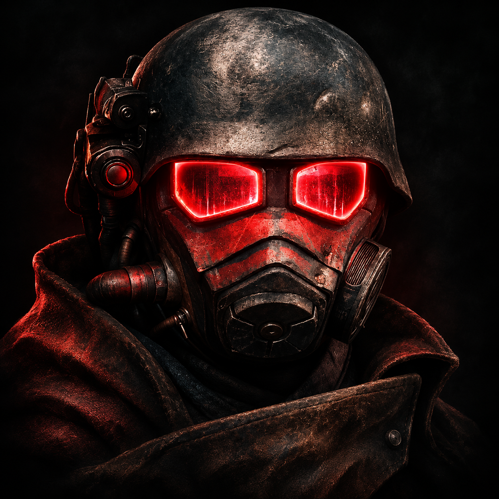

  

# Fallout: New Vegas for iOS

**A touch optimized port of Fallout: New Vegas that runs locally on your iPhone.**

Explore the Mojave using your own PC copy of the game, with controls designed for
the touchscreen: floating movement, swipe aiming, dedicated combat buttons,
optional gyro aiming, and layouts you can customize in the app.

This is an unofficial, experimental port. The original game runs through a native
ARM64 runtime with Metal graphics, alongside an iOS interface for touch controls.

**[Download a test release](https://github.com/arjunyerevan95-dot/FNV-iOS-Shim/releases)**
· **[Installation guide](docs/INSTALL.md)**
· **[Touch controls](docs/TOUCH-CONTROLS.md)**

## Made for touch

- **Floating movement:** place your left thumb anywhere in the movement region;
  lift it to stop and hide the stick.
- **Classic swipe look:** the default restores the earlier 3× aiming response,
  preserving the distance of fast swipes. Drag on Fire to adjust aim while shooting.
- **Six core actions:** Fire, Aim, Interact, Jump, VATS and Pip-Boy stay within reach.
- **Aim your way:** toggle or hold Aim, slide from Aim onto Fire, and adjust the
  shared look multiplier, aiming multiplier and separate horizontal/vertical gains.
- **Optional gyro:** aiming-only or always during gameplay, with calibration,
  inversion and a wider sensitivity range. Gyro stays off in game menus.
- **Utilities without clutter:** hold Pip-Boy for reload, crouch, weapon hotkeys,
  ammunition, camera view, gyro and More.
- **Editable layouts:** move, resize, fade or hide controls; adjust the movement
  and navigation regions; keep separate gameplay and Pip-Boy layouts.

Pip-Boy, dialogue, looting and VATS use contextual controls. Physical-controller
input is retained alongside the touch interface. The [controls guide](docs/TOUCH-CONTROLS.md)
explains the bindings, editor, map controls and recovery gesture.

## What you need

- **iOS 18 or later.** Current device validation is on the project owner's iPhone;
  broader iPhone and iPad coverage is still being tested.
- **A working LiveContainer installation** or another compatible personal signing
  setup. The downloadable IPA is unsigned. Start with the
  [official LiveContainer installation guide](https://livecontainer.github.io/docs/installation/).
- **Your own matching PC installation of Fallout: New Vegas.** Release notes list
  the supported executable identity. The game files and prepared movie files are
  supplied separately from your installation.
- Space for the full game, local movie files and saves. The tested game-content
  installation occupies approximately 10 GB before extra mods.

## Install and play

1. Download the game IPA from a release and import it into LiveContainer.
2. Launch once to create the game's folders.
3. Copy your matching executable, Data folder and configuration files into
   `Documents/FalloutNV` inside **FNVGame's own data container**. The installation
   guide shows the layout and the movie-file preparation step.
4. Relaunch FNVGame, load a save or start New Game, and use the touch overlay to play.

**Updating an existing installation:** update the existing FNVGame entry and keep
its data container. Your game files, saves and settings stay there; they do not
need to be copied again. Back up your saves before updating.

## Current progress

The following have been exercised on the owner's iPhone:

- Doc Mitchell's introduction, including the Vigor Tester and couch sequence,
  followed by gameplay in Goodsprings.
- Dialogue, music, effects, menu sounds, gunfire and intro movie picture/audio.
- Interior/exterior scene changes, saving, loading and reloading after a cold launch.
- Character cast shadows and actor self-shadowing with the documented settings.

Classic swipe/gyro refinements, the app icon and Pip-Boy navigation changes are
being delivered through test releases. Each release states its native-check results
and remaining phone-test steps. Controller/minigame coverage, performance across
devices, extended sessions and mod combinations remain active development areas.

## Controls at a glance

| Action | Touch input |
| --- | --- |
| Move | Floating left stick |
| Look | Swipe the open right region; Fire also supports drag-to-look |
| Aim / block | Aim button; toggle and hold modes are available |
| Fire / attack | Hold Fire |
| Interact / jump | Dedicated buttons |
| Open Pip-Boy | Tap Pip-Boy |
| Utilities | Hold Pip-Boy, then slide and release on a sector |
| Edit controls | Utilities → More → Customize Controls |
| Recover the editor | Hold four fingers for 1.2 seconds |

Local utility wheels and the editor leave the game running. Use the game menu when
you need to pause.

## If something goes wrong

Keep the current run open and copy `Documents/fnv.log` from FNVGame's data container
before launching again. Include the build number, device/iOS version, loaded save
or location, what happened and the shortest sequence that reproduces it.

For missing files, executable mismatch, movie setup and shadow settings, see the
[installation guide](docs/INSTALL.md). For tuning or layout issues, see
[touch controls](docs/TOUCH-CONTROLS.md).

## Development and credits

Build instructions and test entry points are in [DEVELOPMENT.md](docs/DEVELOPMENT.md).
Use the source tag attached to a release when reproducing that build.

This project builds on [Fallout-NV-MacOS](https://github.com/thetheoryofR/Fallout-NV-MacOS)
and its public host/recompiler work. The original host's license is retained in
[upstream/LICENSE](upstream/LICENSE); Ogg/Vorbis notices are included in the IPA.
Fallout: New Vegas and its original content belong to their respective owners.
